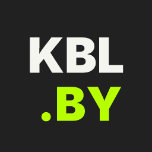
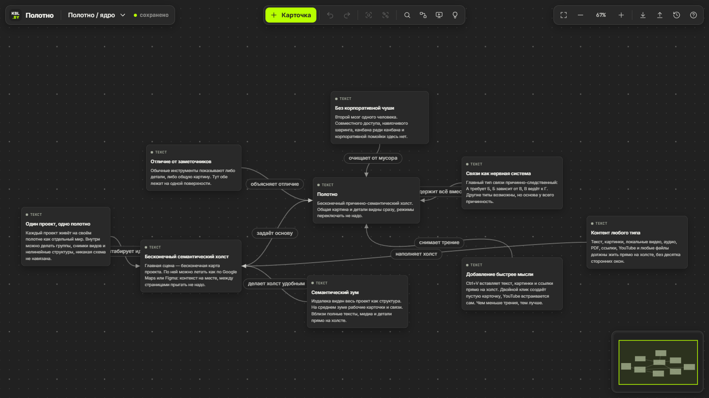
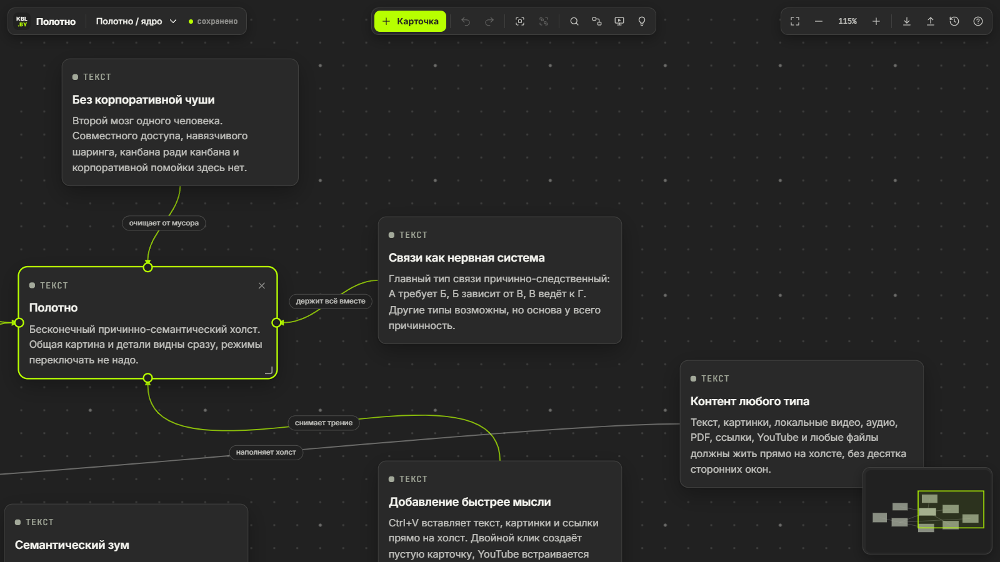
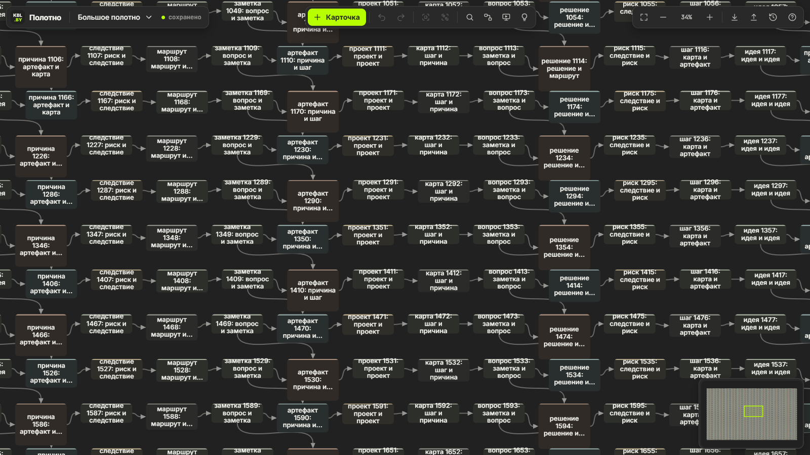
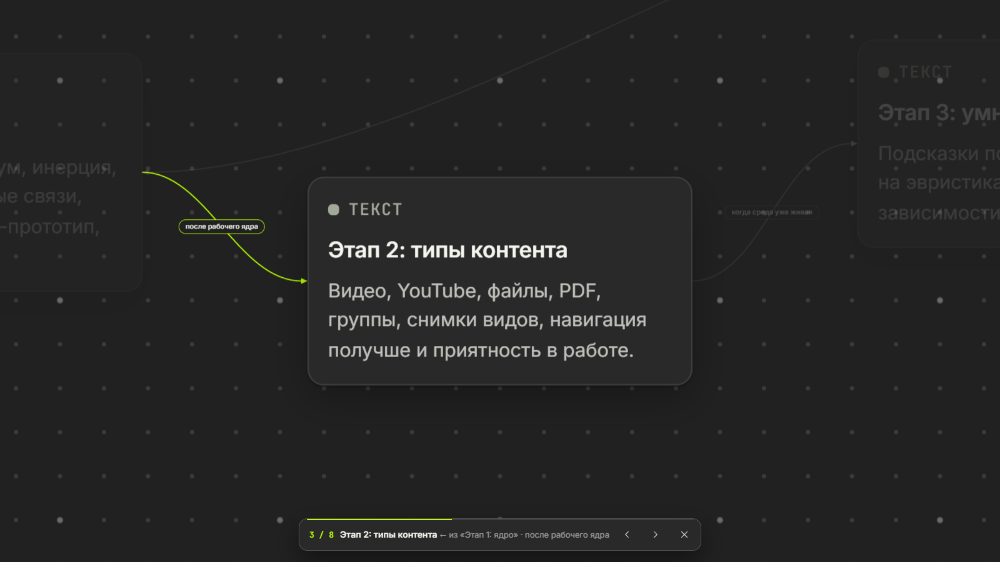
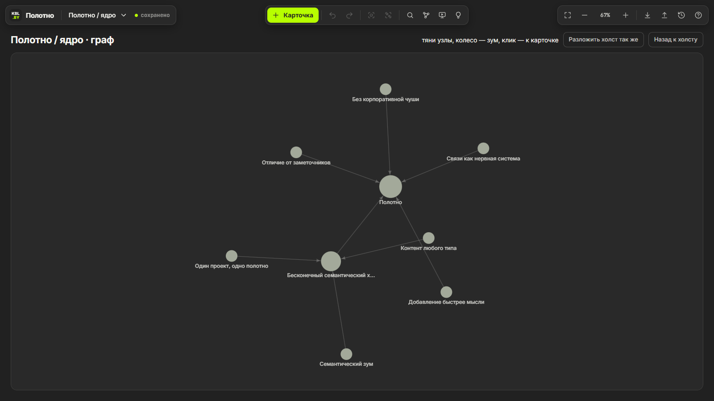
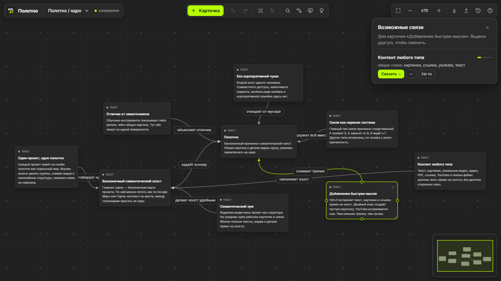
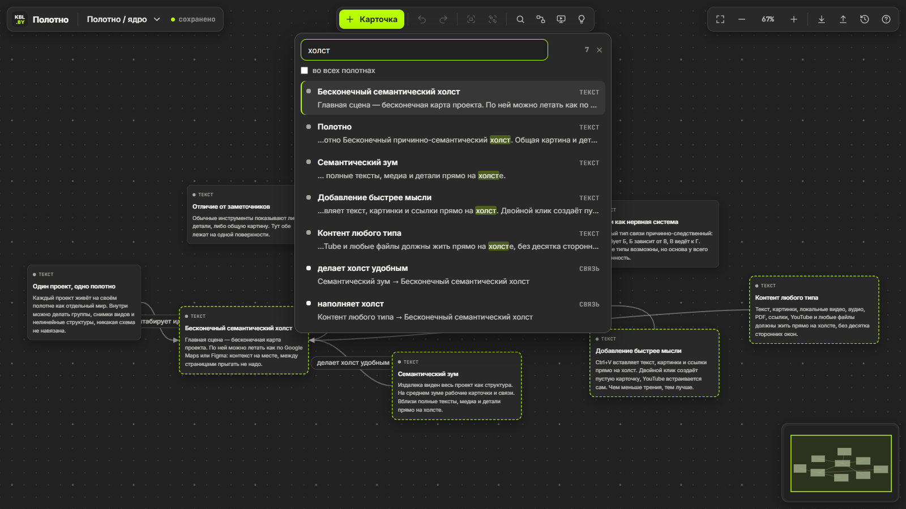
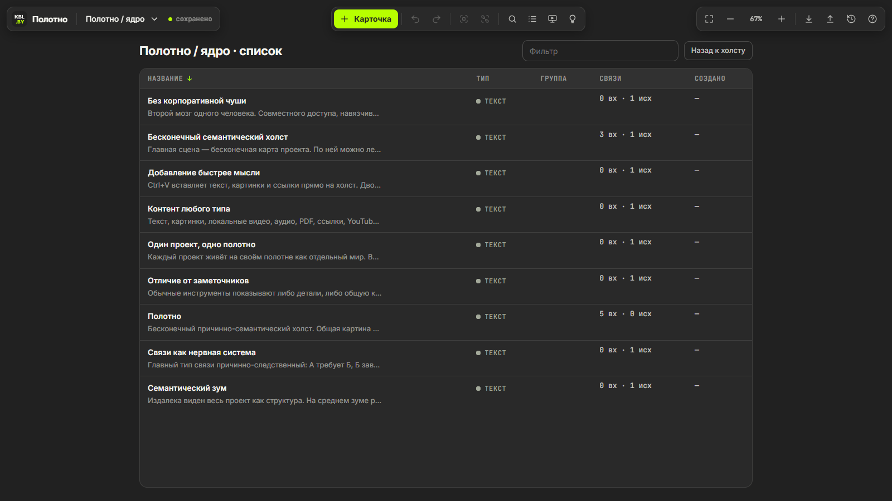

<p align="center">
  
</p>

<h1 align="center">Polotno</h1>

<p align="center">
  An infinite causal-semantic canvas for Windows 10/11: one person's second brain.<br>
  Cards, cause-and-effect links, groups and semantic zoom on a single surface. Local files only. No accounts, no cloud, no telemetry, no nonsense.
</p>

<p align="center">
  <a href="https://github.com/lemitz/Polotno/releases"></a>
  
  
  
  
</p>

<p align="center">
  <b>English</b> · <a href="README.ru.md">Русский</a>
</p>

<p align="center">
  Try it in the browser first: <a href="https://kobyla.by/polotno.html">kobyla.by/polotno.html</a>
</p>

---

Note apps show you either the details or the big picture. Polotno («canvas» in Russian) puts both on one surface. From far away you see the whole project as a structure, at medium zoom the working cards and their links, up close the full texts and media, right on the canvas, with no modes to switch. Links are causal first: A requires B, B leads to C. It is made for one person who needs to see a project whole and in detail at the same time, so there is no sharing, no collaboration and no kanban for the sake of kanban.

This is the desktop build of the canvas that lives on [kobyla.by](https://kobyla.by/artifacts/polotno). The core is the same dependency-free HTML page; the desktop adds what a browser can't do well: every canvas in its own file, attachments of any size, several windows, backups, link and PDF previews, exports, other views of the same canvas, link suggestions, a WebGL renderer for huge canvases and automatic updates. It is built on [Tauri 2](https://tauri.app), so it uses the WebView2 runtime that already ships with Windows instead of bundling a browser engine. The installer is 2.3 MB.

<p align="center">
  
  
</p>
<p align="center">
  
  
</p>
<p align="center">
  
  
</p>
<p align="center">
  
  
</p>

## Features

**Canvas**
- Infinite canvas with smooth pan and zoom toward the cursor (4% to 300%)
- **Semantic zoom** with four levels of detail: full cards → large titles → coloured blocks with headlines → dots. Hover a card far away to see its contents; double-click it to fly there
- Minimap with the current view; drag it to move around
- Frame rate follows the monitor (about 260 FPS on a 260 Hz display) with a cap at 260 FPS; a still canvas draws no frames at all

**Huge canvases**
- On far zoom levels, canvases with 150+ cards are drawn by the GPU (WebGL2): cards as instanced quads with rounded corners in the shader, links as Bézier curves evaluated in the vertex shader, titles from a texture atlas filled within a per-frame budget. Up close the regular DOM cards take over; group frames always stay live DOM
- Cards and links outside the screen are removed from layout entirely
- Measured on 3,000 cards and ~4,000 links while panning: far zoom 18–26 FPS with DOM → **~252 FPS with WebGL**; close zoom 42 → **133 FPS** after the off-screen change

**Cards**
- Nine types: text, Markdown (own lightweight renderer), link, image, video, audio, YouTube, PDF, file
- Double-click the background to create a card, double-click a title or text to edit it in place
- `Ctrl+V` turns whatever is on the clipboard into a card: a link, a YouTube video (embedded), an image, plain text (the first line becomes the title)
- Drag files from Explorer onto the canvas: they are copied into the attachments folder by path, without loading them into memory and without a size limit. `.md` and `.txt` become text cards, `.polotno` files are opened
- **Link previews**: title, description and picture of the page (Open Graph, Twitter Cards, `<title>`), fetched by the app, with the picture stored locally so it works offline
- **PDF previews**: the first page and the page count, rendered by Windows itself (`Windows.Data.Pdf`), so no PDF engine is bundled. *Open* and *Save* buttons for every attachment
- Resize from the corner, collapse and expand long texts, duplicate (`Ctrl+D`), select with `Shift+click` or a `Shift`+drag box

**Links and groups**
- Drag from a dot on a card's edge to another card to link them, or into empty space to create a linked card right there
- Every link can have a label (double-click it); the links of a selected card are highlighted
- Groups (`Ctrl+G`): a named frame around cards. Drag the frame to move everything inside; drop a card into a frame to add it, drag it out to remove it
- **Link suggestions** (`L`), heuristic, no neural networks: TF-IDF similarity over word stems (Russian and English), shared `#tags`, one card mentioning another's title, cards added within minutes of each other, same group. Each suggestion says why, links in either direction with one click, or is dismissed for good

**Views and navigation**
- **Search** (`Ctrl+F`) over titles, texts, link previews, file names, link labels and group names, with highlighted matches on the canvas; `Enter` jumps from one result to the next; optionally across all canvases
- **Other views** of the same canvas (`Shift+1…4`): canvas, a sortable and filterable **list**, a **timeline** by day, and a force-directed **graph** with drag, zoom and *Lay out the canvas the same way* (undoable). A click on a card in any view brings you back to it on the canvas
- **Presentation mode** (`P`): walks the causal route like slides, starting from the selected card or from a root: depth-first, outgoing links first, then incoming, unconnected parts after. Full screen, `←` `→` to move, the caption says how this card relates to the previous one

**Canvases, files and windows**
- Several canvases in one workspace; each canvas can be opened **in its own window** (the window button in the canvas menu), so they can sit on different monitors. A canvas lives in one window at a time; trying to open it in a second one brings up the first
- The workspace is stored as files: `index.json` (the list of canvases) and `projects/<id>.json` (one file per canvas, so windows never overwrite each other), attachments in `attachments/`. Writes go through a temporary file; pending changes are written before a window closes
- **Backups**: a snapshot of all canvases at start-up and every 10 minutes if something changed, plus on demand; the last 40 snapshots and one per day for a month are kept. The *Backups* panel (`Ctrl+H`) restores a single canvas as a copy or rolls the whole workspace back (the current state is snapshotted first, so a rollback can be undone too)
- Own file type **`.polotno`**: a zip with the workspace and the attachments it uses. `Ctrl+S` saves, `Ctrl+O` opens; double-click a `.polotno` file in Explorer to open it in the running app. Old `.polotno` / `.json` files (plain JSON) open as well
- **Export**: PNG or SVG of the whole canvas or of the selection (select a group to export just it), self-contained SVG with fonts and images inside; Markdown for Obsidian with `[[#heading]]` links and attachments copied next to the file; JSON for kobyla.by with attachments inlined
- Undo and redo (`Ctrl+Z` / `Ctrl+Shift+Z`), up to 100 steps per canvas

**Everything else**
- **Automatic updates** for the installed version: a few seconds after start the app checks GitHub Releases, offers the new version and installs it in the background (signed with minisign, the signature is verified before installing), then restarts
- The window remembers its size, position and maximized state; the first start is maximized
- External links open in your default browser
- No telemetry and no accounts. The network is only used for what you ask for: link previews, YouTube previews and embeds, the update check

## Keyboard shortcuts

| Action | Keys |
|---|---|
| New card | double-click the background, `N` |
| Edit a title or text | double-click it |
| Fly to a card from far away | double-click it |
| Paste text, a link, an image | `Ctrl+V` |
| Pan | `Space` + drag, middle mouse button, drag the background |
| Zoom toward the cursor | mouse wheel, `+` / `-` |
| Link two cards | drag from a dot on the card's edge |
| Select several cards | `Shift+click`, `Shift` + drag a box |
| Group / ungroup | `Ctrl+G` / `Ctrl+Shift+G` |
| Select all / duplicate / delete | `Ctrl+A` / `Ctrl+D` / `Del` |
| Undo / redo | `Ctrl+Z` / `Ctrl+Shift+Z` (or `Ctrl+Y`) |
| Fit everything / 100% | `1` / `0` |
| Search | `Ctrl+F` |
| Canvas / list / timeline / graph | `Shift+1` / `Shift+2` / `Shift+3` / `Shift+4` |
| Presentation | `P`, then `←` `→`, `Esc` |
| Link suggestions | `L` |
| Backups | `Ctrl+H` |
| Save to a `.polotno` file / open one | `Ctrl+S` / `Ctrl+O` |
| All shortcuts | `?` |

## Installation

Every release has two flavours:

- **Installer**: `Polotno_<version>_x64-setup.exe` (NSIS). Installs per-user into `%LOCALAPPDATA%\Polotno`, no admin rights needed, registers the `.polotno` file type, adds a Start menu shortcut and updates itself. Available in English and Russian.
- **Portable**: `Polotno_<version>_x64-portable.exe`, a single executable. It keeps the workspace in `%APPDATA%\by.kobyla.polotno` too, but doesn't register the file type and doesn't update itself.

Grab them from the [Releases](https://github.com/lemitz/Polotno/releases) page or [build from source](#building-the-installer). Polotno needs the WebView2 Runtime, which is already present on Windows 11 and up-to-date Windows 10 systems; the installer takes care of it if it's missing. The binaries are not code-signed, so Windows SmartScreen may warn the first time: *More info* → *Run anyway*.

On first start you get four demo canvases that describe Polotno itself. To bring canvases over from the website, press *Download JSON* on [kobyla.by/polotno.html](https://kobyla.by/polotno.html) and open the file with `Ctrl+O`; pictures embedded in it move into the attachments folder.

**Upgrading from 0.4.1**: install 0.5.0 over it. On first start the old `workspace.json` is split into per-canvas files (the original is kept as `workspace.v041.json`) and embedded pictures move into `attachments/`. From 0.5.0 on, updates arrive by themselves.

### About the frame rate

WebView2 renders in step with the monitor, so on a 260 Hz display Polotno runs at 260 FPS and on a 165 Hz one at 165. The page caps rendering at 260 FPS (`FRAME_MS` in `src/index.html`) with frame pacing, so a 360 Hz monitor gets 260 on average. The usual Chromium switches for an unlocked frame rate, `--disable-frame-rate-limit` and `--disable-gpu-vsync`, **don't work in WebView2** and actually drop it to 60 FPS: the first one never reaches the GPU process, the second one switches to a 60 Hz fallback timer.

The WebView2 switches can be overridden without a rebuild through the `POLOTNO_WEBVIEW_ARGS` environment variable, for example `--remote-debugging-port=9222` to attach Chrome DevTools to the running app (`__polotno` is the module API, `__errors` collects page errors).

## Development

Requirements:

- [Node.js](https://nodejs.org) 20 or newer
- [Rust](https://rustup.rs) stable
- The usual [Tauri prerequisites](https://v2.tauri.app/start/prerequisites/) for Windows (MSVC build tools with the Windows SDK, WebView2)

```bash
npm install
npx tauri dev                  # run the app; edits under src/ apply on reload
cd src-tauri && cargo test     # Rust tests (link preview parsing and more)
```

`src/` also works as a plain web page: without Tauri the canvas falls back to `localStorage` and browser downloads, exactly like on kobyla.by, and the desktop-only parts (windows, backups, attachments on disk, previews, updates) switch off.

## Building the installer

```bash
npx tauri build
```

- Installer: `src-tauri/target/release/bundle/nsis/Polotno_<version>_x64-setup.exe`
- Portable executable: `src-tauri/target/release/polotno.exe`

The release profile is tuned for size (`opt-level = "s"`, LTO, symbols stripped). The icons are generated from `src/favicon.svg` with `npx tauri icon src/favicon.svg -o src-tauri/icons` (then delete the `android` and `ios` folders and `icon.icns`).

**Updates.** Releases are signed with a minisign key: the public key is in `tauri.conf.json` (`plugins.updater.pubkey`), the private key is the `TAURI_SIGNING_PRIVATE_KEY` secret of the repository. A signed build is `npx tauri build --config src-tauri/tauri.updater.conf.json` with that variable set; it adds `…-setup.exe.sig`. The app reads `latest.json` from the latest release. Losing the private key means installed copies can no longer be updated automatically, so keep a backup of it. To try an update locally, point `POLOTNO_UPDATE_ENDPOINT` at another `latest.json` (it must be served over HTTPS).

The [Windows workflow](.github/workflows/release.yml) runs for pull requests to `main`, version tags and manual dispatches. It checks that the npm, Rust and Tauri versions match (and match the tag), runs the Rust tests, builds the signed installer and the portable executable, and uploads them plus `SHA256SUMS.txt` as the `polotno-windows` artifact. **Only a pushed version tag publishes a GitHub Release**, with the text from [`RELEASE_NOTES.md`](RELEASE_NOTES.md) and a generated `latest.json` for the updater:

```bash
git tag -a v0.5.0 -m "Polotno v0.5.0"
git push origin v0.5.0
```

The version lives in three places that must agree: `package.json`, `src-tauri/Cargo.toml` and `src-tauri/tauri.conf.json`.

## Project structure

```
src/
  index.html               the canvas core: styles, markup and script, no dependencies; module API
  js/
    gl.js                  WebGL2 renderer for far zoom on large canvases
    search.js              Ctrl+F search
    views.js               list, timeline and graph views
    export.js              PNG, SVG, Markdown export
    present.js             presentation mode
    suggest.js             heuristic link suggestions
    desk.js                desktop only: backups panel, updates
  fonts/                   Inter and JetBrains Mono (woff2) with their licenses
  favicon.svg              logo, also the source of the app icons
src-tauri/
  src/main.rs              app setup, plugins, command list, Explorer file paths
  src/store.rs             index.json and per-canvas files, migration from 0.4.1
  src/wins.rs              windows: one canvas per window, WebView2 switches
  src/att.rs               attachments, .polotno zip export and import, cleanup of unused files
  src/backup.rs            snapshots, rotation, restore
  src/preview.rs           link previews (Open Graph)
  src/pdf.rs               PDF first page via Windows.Data.Pdf
  src/update.rs            update check and install
  tauri.conf.json          window, .polotno file association, NSIS installer, updater key
  tauri.updater.conf.json  extra config for signed release builds
  capabilities/            permissions granted to the windows
docs/images/               screenshots for this README
.github/workflows/         Windows build and release
```

The split is deliberate: the Rust side knows nothing about cards or links. It stores and reads files, copies attachments, fetches pages, renders PDF pages, manages windows and backups. Everything about the canvas lives in `src/`; the modules talk to the core only through the API object that `index.html` hands them.

## Tech stack

[Tauri 2](https://tauri.app) · Rust · vanilla HTML, CSS and JavaScript · WebGL2 · WebView2 · [reqwest](https://github.com/seanmonstar/reqwest) · [zip](https://github.com/zip-rs/zip2) · [windows-rs](https://github.com/microsoft/windows-rs) · [Inter](https://rsms.me/inter/) · [JetBrains Mono](https://www.jetbrains.com/lp/mono/) · NSIS

## License

Polotno is released under the [MIT License](LICENSE). The bundled fonts keep their own license (SIL Open Font License 1.1); see [THIRD-PARTY-NOTICES.md](THIRD-PARTY-NOTICES.md).

---

<p align="center">
  <br>
  <sub>This project was built with the help of AI tools.</sub>
</p>
