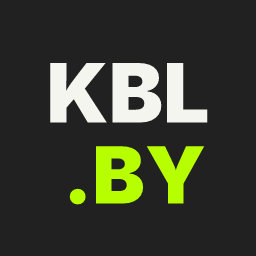
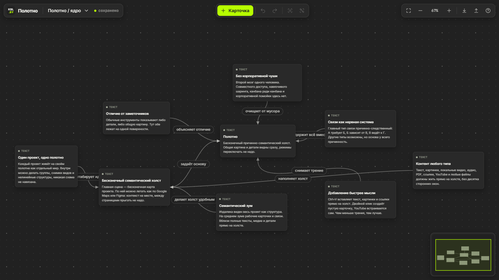
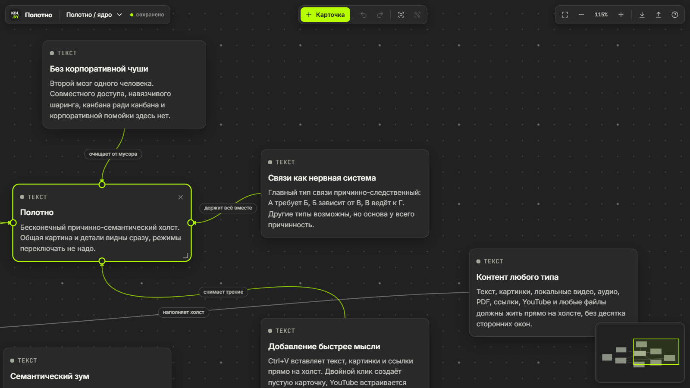
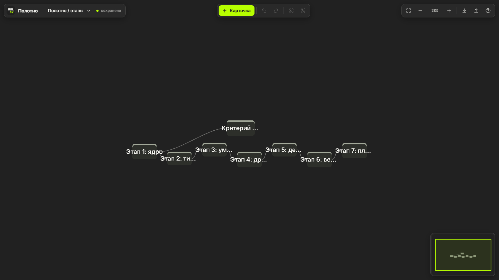
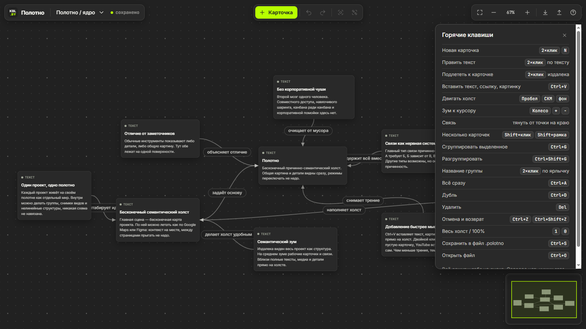

<p align="center">
  
</p>

<h1 align="center">Полотно</h1>

<p align="center">
  Бесконечный причинно-семантический холст для Windows 10/11: второй мозг одного человека.<br>
  Карточки, причинные связи, группы и семантический зум на одной поверхности. Только локальные файлы. Без аккаунтов, облака, телеметрии и прочей чуши.
</p>

<p align="center">
  <a href="https://github.com/lemitz/Polotno/releases"></a>
  
  
  
  
</p>

<p align="center">
  <a href="README.md">English</a> · <b>Русский</b>
</p>

<p align="center">
  Сначала можно пощупать в браузере: <a href="https://kobyla.by/polotno.html">kobyla.by/polotno.html</a>
</p>

---

Заметочники показывают либо детали, либо общую картину. В Полотне обе лежат на одной поверхности. Издалека виден весь проект как структура, на среднем зуме рабочие карточки и связи, вблизи полные тексты и медиа прямо на холсте, и никакие режимы переключать не надо. Связи в первую очередь причинные: А требует Б, Б ведёт к В. Полотно сделано для одного человека, которому надо видеть проект целиком и в деталях одновременно. Поэтому здесь нет совместного доступа, шаринга и канбана ради канбана.

Это десктопная сборка холста, который живёт на [kobyla.by](https://kobyla.by/artifacts/polotno). Интерфейс тот же: один HTML-файл без зависимостей. Десктопный слой добавляет то, что браузер делает плохо: данные в настоящем файле на диске, свой тип файла, отрисовку с частотой монитора и нормальное окно. Под капотом [Tauri 2](https://tauri.app): вместо встроенного браузерного движка используется WebView2, который уже есть в Windows. Установщик весит 1.4 МБ.

<p align="center">
  
  
</p>
<p align="center">
  
  
</p>

## Возможности

**Холст**
- Бесконечный холст, плавный пан и зум к курсору (от 4% до 300%), отрисовка через `translate3d` в `requestAnimationFrame`
- **Семантический зум**, четыре уровня детализации: полные карточки → крупные заголовки → цветные блоки с названиями → точки. На дальнем зуме при наведении всплывает содержимое карточки, двойной клик подлетает к ней
- Миникарта с текущим видом, по ней можно таскаться
- Карточки и связи за краем экрана не отрисовываются, а на неподвижном холсте кадры не рисуются вообще

**Карточки**
- Восемь типов: текст, Markdown (свой лёгкий рендер), ссылка, картинка, видео, аудио, YouTube, файл
- Двойной клик по фону создаёт карточку, двойной клик по заголовку или тексту открывает правку на месте
- `Ctrl+V` превращает содержимое буфера в карточку: ссылку, YouTube-ролик (встраивается), картинку или текст (первая строка становится заголовком)
- Файлы можно кидать из проводника прямо на холст: картинки ужимаются в WebP, `.md` и `.txt` становятся текстовыми карточками, остальные файлы до 16 МБ встраиваются целиком
- Размер меняется за угол, длинные тексты сворачиваются и разворачиваются, `Ctrl+D` дублирует, выделять можно `Shift+клик` или рамкой с `Shift`

**Связи и группы**
- Тянешь от точки на краю карточки к другой карточке, и появляется связь. Если отпустить в пустоте, там сразу создастся связанная карточка
- У каждой связи может быть подпись (двойной клик по ней), связи выделенной карточки подсвечиваются
- Группы (`Ctrl+G`): рамка с названием вокруг карточек. Тянешь рамку, едет всё содержимое. Бросил карточку в рамку, и она в группе, вытащил наружу, и она из неё ушла

**Полотна и файлы**
- Несколько полотен (проектов) в одной рабочей области, переключаются из меню рядом с логотипом
- Рабочая область сама сохраняется в `%APPDATA%\by.kobyla.polotno\workspace.json` через временный файл, так что сбой посреди записи не оставит битый файл. Перед закрытием окна несохранённое дописывается
- Свой тип файла **`.polotno`**: `Ctrl+S` сохраняет рабочую область через системный диалог, `Ctrl+O` открывает. При открытии Полотно спрашивает, заменить текущую область или добавить полотна из файла рядом
- Двойной клик по `.polotno` в проводнике открывает файл. Окно всегда одно: если Полотно уже запущено, файл уходит в открытое окно
- `.polotno` — обычный JSON в том же формате, что и экспорт на kobyla.by, так что полотна переносятся между сайтом и приложением в обе стороны
- Отмена и возврат (`Ctrl+Z` / `Ctrl+Shift+Z`), до 100 шагов на полотно

**Остальное**
- Частота кадров идёт за монитором (около 260 FPS на мониторе 260 Гц), потолок 260 FPS. На мониторах выше, например 360 Гц, кадры в среднем держатся на 260
- Окно запоминает размер, положение и развёрнутость, при первом запуске стартует развёрнутым
- Внешние ссылки открываются в браузере по умолчанию, встроенные файлы сохраняются через диалог
- Браузерное контекстное меню, `F5` и `Ctrl+R` / `Ctrl+P` отключены, чтобы приложение вело себя как приложение
- Ни телеметрии, ни проверки обновлений. Сеть нужна только тому, что ты сам положил на холст: превью и плееру YouTube, картинкам по ссылке

## Горячие клавиши

| Действие | Клавиши |
|---|---|
| Новая карточка | двойной клик по фону, `N` |
| Править заголовок или текст | двойной клик по нему |
| Подлететь к карточке издалека | двойной клик по ней |
| Вставить текст, ссылку, картинку | `Ctrl+V` |
| Двигать холст | `Пробел` + тянуть, средняя кнопка мыши, тянуть за фон |
| Зум к курсору | колесо мыши, `+` / `-` |
| Связать две карточки | тянуть от точки на краю карточки |
| Выделить несколько | `Shift+клик`, рамка с `Shift` |
| Сгруппировать / разгруппировать | `Ctrl+G` / `Ctrl+Shift+G` |
| Переименовать группу | двойной клик по ярлычку |
| Выделить всё / дубль / удалить | `Ctrl+A` / `Ctrl+D` / `Del` |
| Отмена / возврат | `Ctrl+Z` / `Ctrl+Shift+Z` (или `Ctrl+Y`) |
| Весь холст / 100% | `1` / `0` |
| Сохранить в `.polotno` / открыть | `Ctrl+S` / `Ctrl+O` |
| Все клавиши | `?` |

## Установка

Каждая сборка даёт два варианта:

- **Установщик** `Polotno_<версия>_x64-setup.exe` (NSIS). Ставит для текущего пользователя в `%LOCALAPPDATA%\Polotno`, права админа не нужны. Регистрирует тип файла `.polotno` и добавляет ярлык в Пуск. Есть на английском и русском.
- **Портативная версия** `Polotno_<версия>_x64-portable.exe`, один исполняемый файл. Рабочую область она тоже хранит в `%APPDATA%\by.kobyla.polotno`, но тип файла не регистрирует.

Оба файла лежат на странице [Releases](https://github.com/lemitz/Polotno/releases), можно и [собрать самому](#сборка-установщика). Полотну нужен WebView2 Runtime. В Windows 11 и обновлённой Windows 10 он уже есть, а если нет, установщик поставит его сам. Файлы не подписаны, поэтому при первом запуске SmartScreen может ругнуться: *Подробнее* → *Выполнить в любом случае*.

При первом запуске открываются четыре демо-полотна, которые описывают само Полотно. Чтобы перенести полотна с сайта, нажми *Скачать JSON* на [kobyla.by/polotno.html](https://kobyla.by/polotno.html) и открой файл в приложении через `Ctrl+O`.

### Про частоту кадров

WebView2 рисует в такт монитору: на 260 Гц Полотно выдаёт 260 FPS, на 165 Гц 165. Сверху страница сама ограничивает отрисовку 260 FPS (`FRAME_MS` в `src/index.html`). Привычные флаги Chromium для снятия лимита, `--disable-frame-rate-limit` и `--disable-gpu-vsync`, **в WebView2 не работают**, а наоборот роняют частоту до 60 FPS: первый не доходит до GPU-процесса, второй включает запасной таймер на 60 Гц. Поэтому они выключены.

Флаги WebView2 можно переопределить без пересборки через переменную окружения `POLOTNO_WEBVIEW_ARGS`. Например, `--remote-debugging-port=9222` позволяет подключить к работающему приложению Chrome DevTools.

## Разработка

Нужны:

- [Node.js](https://nodejs.org) 20 или новее
- [Rust](https://rustup.rs) stable
- Стандартные [зависимости Tauri](https://v2.tauri.app/start/prerequisites/) для Windows (MSVC Build Tools с Windows SDK, WebView2)

```bash
npm install
npx tauri dev        # запустить приложение; правки в src/index.html перезагружают окно
```

`src/index.html` работает и как обычная страница: без Tauri он хранит данные в `localStorage` и скачивает файлы через браузер, ровно как на kobyla.by. Холст можно править без Rust, открыв файл через любой статический сервер.

## Сборка установщика

```bash
npx tauri build
```

- Установщик: `src-tauri/target/release/bundle/nsis/Polotno_<версия>_x64-setup.exe`
- Портативный exe: `src-tauri/target/release/polotno.exe`

Релизный профиль настроен на размер (`opt-level = "s"`, LTO, без символов). Иконки генерируются из `src/favicon.svg`: `npx tauri icon src/favicon.svg -o src-tauri/icons` (потом удалить папки `android` и `ios` и `icon.icns`).

[Workflow для Windows](.github/workflows/release.yml) запускается на пулл-реквесты в `main`, теги версий и вручную. Он проверяет, что версии в npm, Rust и Tauri совпадают между собой и с тегом, собирает установщик и портативный exe и прикладывает их вместе с `SHA256SUMS.txt` как артефакт `polotno-windows`. **Релиз на GitHub публикуется только по пушу тега версии**, текст берётся из [`RELEASE_NOTES.md`](RELEASE_NOTES.md):

```bash
git tag -a v0.4.1 -m "Polotno v0.4.1"
git push origin v0.4.1
```

Версия живёт в трёх местах, и они должны совпадать: `package.json`, `src-tauri/Cargo.toml` и `src-tauri/tauri.conf.json`.

## Структура проекта

```
src/
  index.html               весь холст: стили, разметка и скрипт, без зависимостей
  fonts/                   Inter и JetBrains Mono (woff2) с лицензиями
  favicon.svg              логотип, из него же делаются иконки приложения
src-tauri/
  src/main.rs              создание окна и флаги WebView2, файл рабочей области, команды чтения
                           и записи файлов, .polotno из командной строки, одно окно на всех
  tauri.conf.json          окно, ассоциация .polotno, установщик NSIS
  capabilities/            права главного окна
  icons/                   иконки приложения из favicon.svg
docs/images/               скриншоты для README
.github/workflows/         сборка и релиз под Windows
```

Разделение сделано нарочно: Rust-часть ничего не знает о карточках и связях. Она читает и пишет текст и байты, создаёт окно и передаёт пути файлов из проводника. Всё про холст живёт в `src/index.html`, и его можно без правок положить на сайт вместо `polotno.html`.

## Стек

[Tauri 2](https://tauri.app) · Rust · чистые HTML, CSS и JavaScript · WebView2 · [Inter](https://rsms.me/inter/) · [JetBrains Mono](https://www.jetbrains.com/lp/mono/) · NSIS

## Лицензия

Полотно распространяется по [лицензии MIT](LICENSE). У встроенных шрифтов своя лицензия (SIL Open Font License 1.1), подробности в [THIRD-PARTY-NOTICES.md](THIRD-PARTY-NOTICES.md).

---

<p align="center">
  <br>
  <sub>Проект сделан с помощью ИИ-инструментов.</sub>
</p>
